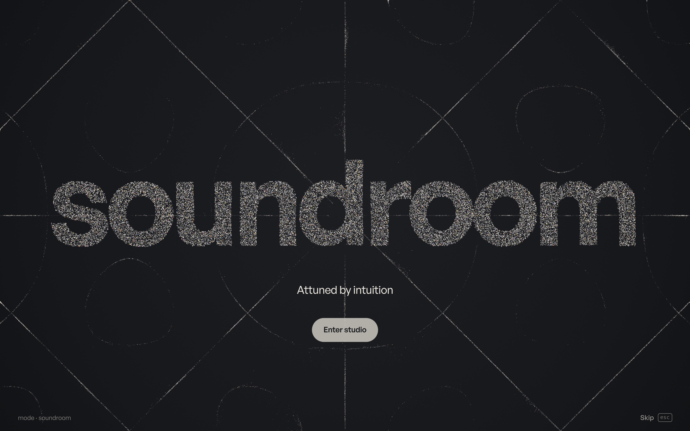
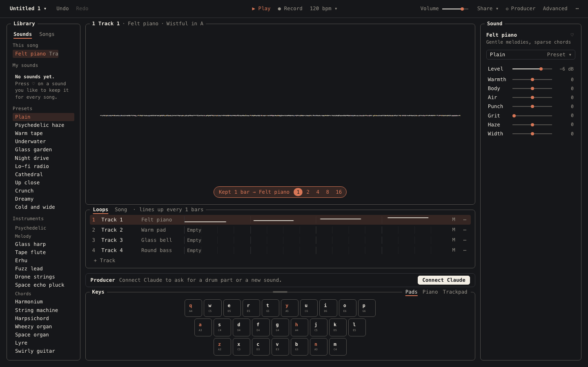
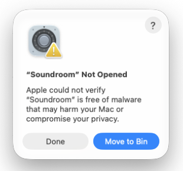

# Soundroom

**A studio for people who don't have one.**

Your laptop's letter keys are the instrument. Every key is in the mood you pick, so nothing you play clashes. Shape the sound with sliders named by what you hear: Warmth, Body, Air, Punch, Grit, Haze, Width. Play something you like, press Enter, and it becomes a loop.

**[Download Soundroom 0.2.0 for Mac](https://github.com/bendrvry/soundroom/releases/latest)**: Apple silicon (M1 or newer), macOS 15 or later.





## Install

Soundroom isn't signed by Apple yet, so the first time you open it macOS asks you to confirm. You only do this once.

1. **Download** `Soundroom-0.2.0-arm64.dmg` from the [latest release](https://github.com/bendrvry/soundroom/releases/latest), open it, and drag **Soundroom** into **Applications**.
2. **Open Soundroom** from Applications. macOS says "Soundroom" Not Opened. Click **Done** (not Move to Bin).

   

3. **Open System Settings › Privacy & Security** and scroll down to **Security**. Next to "Soundroom was blocked", click **Open Anyway**, then enter your password or use Touch ID. Do this within an hour of step 2, or the button goes away and you start again from step 2.
4. **Click Open** in the box that appears. From now on Soundroom opens like any other app.

Use wired headphones or the built-in speakers: Bluetooth adds a delay you can hear when you play.

**If macOS says Soundroom is damaged**, run this in Terminal, then open it again:

```bash
xattr -dr com.apple.quarantine /Applications/Soundroom.app
```

## Trying it for Ben

If Ben sent you this link, [the friend test](FRIEND-TEST.md) takes about fifteen minutes.

## Feedback

**⋯ › Send feedback** in the app opens an email to Ben with the version filled in. Nothing is sent until you press Send.

## More

- [Known issues](KNOWN-ISSUES.md)
- Your songs stay on your Mac. Exports go to **Music › Soundroom**.
- When there's a new version, **New version** appears in the ⋯ menu.

Soundroom is made by [Ben Drury](https://bendrury.uk). All rights reserved; the app is free to use. Built-in sounds come from openly licensed libraries; the full list is under ⋯ › Credits in the app.
